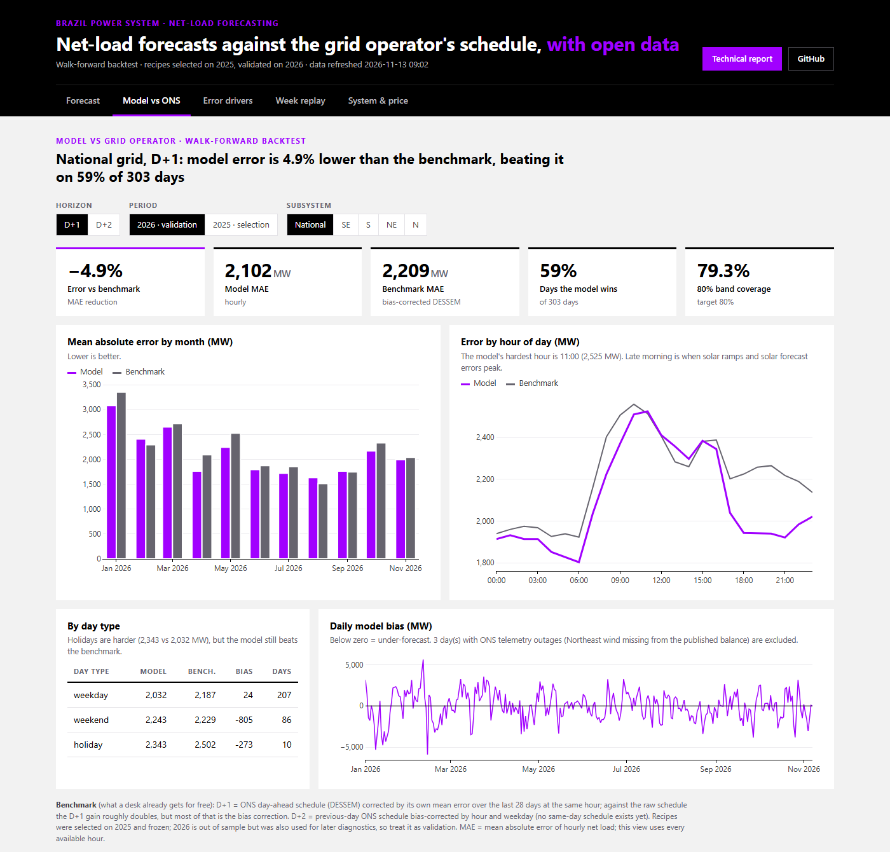
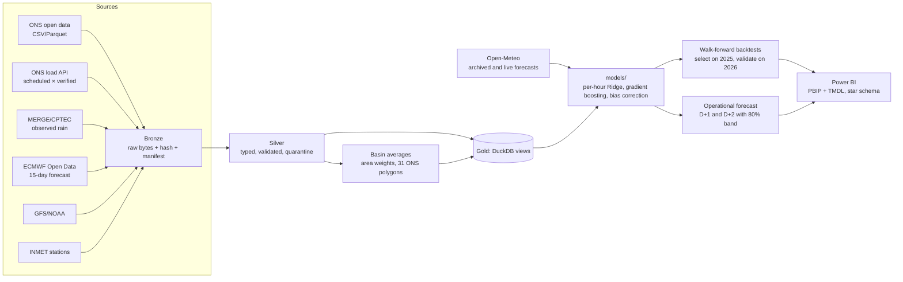

# Energy: data pipeline and forecasting for the Brazilian power system

An end-to-end data and modelling project inspired by what power trading desks use to follow the grid. It
ingests **official grid-operator data** (Brazil's ONS: CSV/Parquet files **and** APIs) and **weather data**
(observed and forecast), organises it in **Bronze → Silver → Gold** layers, and ends in a **daily
net-load forecast** (load − wind − solar) for tomorrow and the day after, scored against the operator's
own schedule and published in a **Power BI dashboard**.

> **Interactive dashboard: [docs/dashboard/index.html](docs/dashboard/index.html)** — a single HTML file; download it and open it in any browser (preview below).
>
> Personal study and portfolio project. **Technical report: [docs/paper.md](docs/paper.md) · One-page results: [docs/results.md](docs/results.md).**

| Forecast (walk-forward: recipe chosen on 2025, scored on 2026) | Fair benchmark (what a desk already has for free) | MAE reduction |
|---|---|---|
| Net load D+1, national grid, hourly | Operator's day-ahead schedule (DESSEM) **corrected by its own 28-day bias** | **5.0%** (2,097 vs 2,207 MW; 95% CI of the gain 21–172 MW) |
| Net load D+2, before any official schedule exists | Previous-day schedule, bias-corrected by hour and weekday | **25.7%** (2,602 vs 3,500 MW) |
| River inflow by basin, 1 day after the last published value | Persistence | 30.5% (ENA is published the next morning, so the effective lead is about a day shorter) |

**How to read this honestly.** Against the *raw* DESSEM schedule the D+1 gain is 11.3%, but 6.6 points of that come
from a simple bias correction anyone can apply, so the fair figure is 5.0%. The D+1 "model" is itself half the
operator's schedule: load and wind are 50/50 blends of ML with the bias-corrected DESSEM, and solar is the
bias-corrected DESSEM alone; on its own, ML loses to the operator at D+1. The real modelling edge is at **D+2**,
where no official schedule exists yet and pure ML wins for load and wind. Once ONS publishes its D+1 schedule,
that schedule (bias-corrected) is better than our D+2 forecast, as it should be.



## The business question

Brazil's spot price (CMO/PLD) is set by an operator model that balances **net load** against hydro,
thermal and interconnections. A desk gains an edge when it anticipates net load better than the free
public references, or before they are published. Two things move the price:

1. **The operator's load-forecast error**: scheduled vs. verified load.
2. **Rain inside the hydro basins**, observed and forecast, which precedes inflows and reservoir storage.

The pipeline exists so these questions can be answered with traceable, reproducible data.

## Architecture



| Layer | Guarantees |
|---|---|
| **Bronze** | Bytes exactly as received, addressed by SHA-256. Every source revision is preserved and every attempt is logged in SQLite |
| **Silver** | Schema contract per dataset, types, normalised keys, invalid rows quarantined (never silently fixed), lineage to the source file and transformation version |
| **Gold** | Basin weather averages and business views in DuckDB (no data copies) |
| **Models** | Use only what existed at decision time (leakage tests), on cleaned data (night-time solar, frozen values, incomplete schedules) |
| **BI** | Star schema in Parquet, a static single-file HTML dashboard (Plotly) and a Power BI project as code (TMDL model, 54 DAX measures, 5 report pages generated by script) |

## Sources

| Source | Content | Cadence |
|---|---|---|
| ONS open data portal (CKAN) | 37 tabular datasets plus the basin polygons: energy balance, generation, storage/inflow by basin and subsystem, marginal cost, interchange, wind/solar curtailment… | Hourly (hydrology: 15 min) |
| ONS load API | **Scheduled** (D, D+1) and **verified** load incl. distributed generation, per subsystem, UTC | Hourly / 6 h |
| MERGE/CPTEC | Observed daily rain, 0.1° | Hourly (last 3 days) |
| ECMWF IFS Open Data | Forecast rain, temperature and runoff, up to 15 days | Daily (00z run) |
| GFS/NOAA | 24/48/72 h forecast | Hourly |
| INMET | Automatic weather stations | Daily |
| Open-Meteo | Forecasts **archived as issued** (GFS and ECMWF, 48/72/96 h ahead) and live forecasts at plant and city locations. CC-BY 4.0, non-commercial use | On demand |
| CCEE (official spot price) | Connector ready but disabled: CCEE's firewall blocks the egress IP (HTTP 403); price is estimated from marginal cost | — |

Details and limitations: [docs/sources.md](docs/sources.md), [docs/pipeline_diario.md](docs/pipeline_diario.md) and [docs/architecture.md](docs/architecture.md).

## Key results

- **D+1 net load:** 2,097 MW hourly MAE in 2026 vs. 2,207 MW for the bias-corrected operator schedule (−5.0%; 95% CI of the difference −172 to −21 MW, 14-day block bootstrap) and 2,364 MW for the raw schedule (−11.3%). The edge comes from blending ML with the operator, not from ML alone.
- **D+2 net load:** −25.7% vs. the bias-corrected previous-day schedule (CI −1,186 to −575 MW), and it anticipates the schedule ONS has not yet published with 25% less error.
- **Weather forecasts carry the ML skill:** with the same Ridge model, archived weather forecasts cut D+1 error by 32% (wind), 22% (solar) and 17% (load).
- **80% prediction band** by resampling past errors: 79.3% (D+1) and 79.5% (D+2) coverage in 2026.
- **Honest negatives:** extra heat features, a second-stage residual model and fuzzy-logic risk bands were tested and **did not** beat the simpler model out of sample; they are documented, not shipped.
- **Week replay:** forecasts rebuilt with data cut at 10 pm the day before (Nov 4–10, 2026; inputs are today's revised values, so this is a replay, not a true as-of run): D+2 beat its benchmark by 20%; D+1 lost 5.2% to the bias-corrected schedule during a heat wave, when the operator's bias flipped sign.
- **2026 is a validation year, not a pristine test set:** several design checks (bias-correction window, residual models, fuzzy bands) were run on it. The recipes are now frozen; the stored daily operational forecasts from Nov 2026 onwards are the clean out-of-sample test.

## How to run

```powershell
# 1. Environment (Windows, Python 3.13)
python -m venv .venv
.\.venv\Scripts\python.exe -m pip install -r requirements-dev.txt

# 2. Incremental ingestion: Bronze → Silver → Gold
.\.venv\Scripts\python.exe scripts/pipeline.py

# 3. History (plans and shows sizes by default; --execute downloads). Includes the DESSEM schedule
#    (balanco_dessem_detalhe) needed by the backtests. Full history: ~4.5 GB Bronze + ~3.3 GB Silver.
.\.venv\Scripts\python.exe scripts/backfill.py --sources ons,load --start 2018-01-01
.\.venv\Scripts\python.exe scripts/backfill.py --sources ons,load --start 2018-01-01 --execute

# 4. Archived weather forecasts for the models (Open-Meteo, free for non-commercial use; a few thousand calls)
.\.venv\Scripts\python.exe scripts/baixar_previsao_renovaveis.py --dias 2 3    # wind/solar at plant locations, D+1 and D+2
.\.venv\Scripts\python.exe scripts/baixar_temperatura_prevista.py --dias 2 3   # temperature at capital cities
.\.venv\Scripts\python.exe scripts/gold.py                                     # refresh the Gold views

# 5. Query the views
.\.venv\Scripts\python.exe -c "import duckdb; c=duckdb.connect('data/gold/energia.duckdb', read_only=True); print(c.sql('FROM vw_carga_prevista_vs_verificada LIMIT 5'))"

# 6. Re-run the backtests (D+1 and D+2, ~1.5 min each). --ate YYYY-MM-DD pins the last day to reproduce a past run
#    (the published results use --ate 2026-11-07); without it, newer data and ONS revisions move the numbers slightly.
.\.venv\Scripts\python.exe scripts/carga_liquida_d1.py --ate 2026-11-07
.\.venv\Scripts\python.exe scripts/carga_liquida_d1.py --horizonte 2 --ate 2026-11-07

# 7. Tomorrow's and the day after's net-load forecast (best after 8 pm Brasília time; needs step 6)
.\.venv\Scripts\python.exe scripts/prever_carga_liquida.py

# 8. BI: star-schema tables, the HTML dashboard (docs/dashboard/index.html) and the Power BI project (bi/Energia.pbip)
.\.venv\Scripts\python.exe scripts/exportar_bi.py
.\.venv\Scripts\python.exe scripts/gerar_dashboard_html.py
.\.venv\Scripts\python.exe scripts/gerar_projeto_bi.py

# 9. Status and tests
.\.venv\Scripts\python.exe scripts/status_pipeline.py
.\.venv\Scripts\python.exe -m pytest -q tests
```

- **Scheduling:** `scripts/install_pipeline_task.ps1` registers a Windows Task Scheduler job (every 15 min; each source has its own cadence).
- **Data on another drive:** set `ENERGY_DATA_DIR` or use a junction for `data/`.

## Repository layout

```
configs/             schema contracts, collection policies, basin mapping
scripts/             pipeline (acquire, pipeline, silver, basins, gold, backfill, status), backtests, forecast, BI export
models/              Gold readers, data cleaning, models (load, renewables, inflow), validation and operations
bi/                  Power BI project as code (PBIP + TMDL) and dashboard guide
scripts/preparacao/  inventory and contract generators (run only if a source changes)
scripts/diagnostico/ audits and one-off investigations (residual diagnostics, fuzzy-logic test)
tests/               offline tests (pytest), including leakage tests
docs/                architecture, sources, views, research notes, inventories
data/                (not in git) bronze/ silver/ gold/ bi/ runs/
```

## Engineering decisions worth highlighting

- **Content-based idempotency:** HEAD/ETag avoids repeated downloads and hashing avoids duplicate objects. Silver is reused while input and version are unchanged.
- **Transformation versioning:** changes when the contract, a quality threshold or the `silver.py` code changes; changing collection frequency reprocesses nothing.
- **No invented time zones:** only the load API and weather data declare UTC; everything else stays "as published", flagged as unverified.
- **Correct basin averages:** each grid cell's area inside the polygon is computed in an equal-area projection (EPSG:5880); missing cells never become zero.
- **Revisions:** the operator revises published data; every revision is kept in Bronze with its availability time, and Gold views take the latest revision per key. Backtests and the week replay use revised values (a known limitation); a true as-of rebuild from the Bronze vintages is possible but not implemented.
- **Visible failures:** a failing source does not break the others; the run is marked `partial` and the status report alerts when scheduling stops.
- **No look-ahead:** every feature uses only what existed at 10 pm the day before (verified data to D−1, weather issued 48 or 72 h earlier), and each walk-forward fold stops training at the last target known when its first day is forecast. Tests perturb the future (including the fold boundary) and check that nothing changes.
- **A fair benchmark before celebrating:** every model is scored against what a desk already gets for free (bias-corrected operator schedule, or weekday-corrected for D+2). A first "42% gain" for D+2 dropped to 26% with the right benchmark, and the D+1 headline is the 5% over the corrected schedule, not the 11% over the raw one.

## Results and research

- [docs/paper.md](docs/paper.md): technical report (data, methodology, results, negative results, limitations).
- [docs/results.md](docs/results.md): summary, audits, limitations and next steps (English).
- [bi/README.md](bi/README.md): Power BI dashboard (star schema, DAX measures, pages).
- Detailed research notes: [net load D+1](docs/research/carga_liquida_d1.md), [net load D+2](docs/research/carga_liquida_d2.md), [load D+1](docs/research/carga_d1.md), [inflow and daily load](docs/research/modelagem_meteorologia_energia.md), [solar and seasonality](docs/research/solar_e_sazonalidade.md).

**Next step:** link the D+2 net-load forecast to the estimated spot price and test whether it anticipates price moves. A second market module for **Ontario (IESO)** is planned with the same architecture.

---
*Data: ONS (open data), CPTEC/INPE (MERGE), NOAA (GFS), INMET, ECMWF Open Data (CC-BY-4.0) and Open-Meteo (CC-BY 4.0).*
