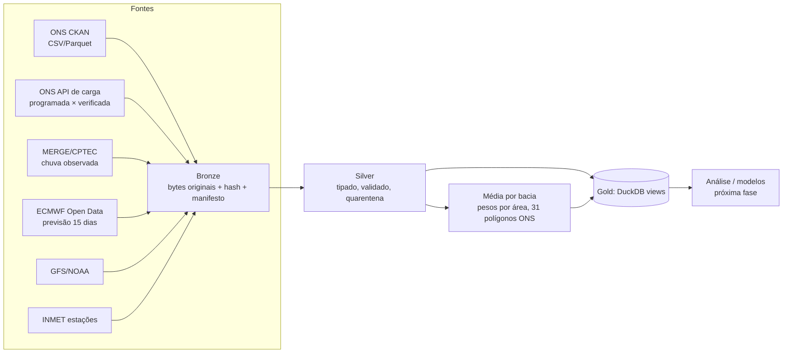

# Energy: pipeline de dados do setor elétrico brasileiro

Pipeline de **engenharia de dados** inspirado no que mesas de comercialização de energia usam para acompanhar o sistema elétrico. Ele coleta dados **oficiais do ONS** (arquivos CSV/Parquet do portal **e** APIs) e **meteorologia** (observada e prevista) e organiza tudo em camadas **Bronze → Silver → Gold**, até chegar a views SQL prontas para análise e, numa fase futura, para modelos de previsão.

> Projeto pessoal de estudo e portfólio. A fase atual é a **engenharia de dados**. Modelagem estatística e ML vêm depois, consumindo as views da camada Gold.

## A pergunta de negócio

No Brasil, o preço de curto prazo (CMO/PLD) depende de **quanta água vai chegar aos reservatórios** e de **quanta carga o sistema vai atender**. Duas coisas antecipam esse preço:

1. **O erro da previsão de carga do operador**: a carga programada pelo ONS comparada com a carga verificada.
2. **A chuva dentro das bacias**, observada e prevista, que antecede a ENA (energia natural afluente) e a EAR (energia armazenada).

O pipeline existe para que essas perguntas possam ser respondidas com dados rastreáveis.

## Arquitetura



| Camada | O que garante |
|---|---|
| **Bronze** | Bytes exatamente como recebidos, endereçados por SHA-256. Cada revisão da fonte é preservada, e cada tentativa fica registrada em SQLite |
| **Silver** | Contrato de schema por conjunto, tipos, chaves normalizadas, linhas inválidas em quarentena (nunca corrigidas em silêncio), linhagem até o arquivo de origem e versão da transformação |
| **Gold** | Médias meteorológicas por bacia e views de negócio no DuckDB (sem cópia de dados) |

## Fontes

| Fonte | Conteúdo | Frequência no pipeline |
|---|---|---|
| ONS (portal CKAN) | 37 conjuntos: balanço, geração, EAR/ENA por bacia/REE/subsistema, CMO, intercâmbio, restrições eólica/solar… | Horária (hidrologia: 15 min) |
| ONS (API `apicarga`) | Carga **programada** (D, D+1) e **verificada** com MMGD, por subsistema, em UTC | Horária / 6 h |
| MERGE/CPTEC | Chuva diária observada, 0,1° | Horária (últimos 3 dias) |
| ECMWF IFS Open Data | Chuva, temperatura e escoamento previstos, até 15 dias | Diária (rodada 00z) |
| GFS/NOAA | Previsão 24/48/72 h | Horária |
| INMET | Estações automáticas | Diária |
| CCEE (PLD) | Conector pronto e desligado: o firewall da CCEE bloqueia o IP de saída (HTTP 403) | — |

Detalhes, decisões e limitações de cada fonte: [docs/sources.md](docs/sources.md), [docs/pipeline_diario.md](docs/pipeline_diario.md) e a [pesquisa de fontes e modelos](docs/research/meteorologia_bacias_e_modelos.md).

## Primeiros resultados (das views Gold)

- **Previsão de carga do ONS (2021–2026):** o erro percentual médio absoluto da carga programada contra a verificada fica entre **2,6% e 4,4%** ao ano (2022 foi o pior ano, 2024 o melhor). A carga programada da API começa em 2021.
- **Chuva × ENA (2018–2026, 3.235 dias):** a chuva acumulada em 15 dias por bacia correlaciona com a ENA de 7 dias depois em **0,8 no Grande, 0,78 no Tocantins e 0,77 no Paranaíba**, mas só **0,3 a 0,4 no Uruguai e no Jacuí**. As bacias do Sul respondem rápido e não têm estação seca marcada. Parte da correlação alta é sazonalidade. A vantagem real só aparece comparando com a previsão do próprio ONS, o que fica para a fase de modelagem.

## Como rodar

```powershell
# 1. Ambiente (Windows, Python 3.13)
python -m venv .venv
.\.venv\Scripts\python.exe -m pip install -r requirements-dev.txt

# 2. Coleta incremental: Bronze → Silver → Gold
.\.venv\Scripts\python.exe scripts/pipeline.py

# 3. Histórico (por padrão só PLANEJA e mostra o tamanho; --execute baixa)
.\.venv\Scripts\python.exe scripts/backfill.py --sources ons,load --start 2018-01-01

# 4. Consultar as views
.\.venv\Scripts\python.exe -c "import duckdb; c=duckdb.connect('data/gold/energia.duckdb', read_only=True); print(c.sql('FROM vw_carga_prevista_vs_verificada LIMIT 5'))"

# 5. Estado e testes
.\.venv\Scripts\python.exe scripts/status_pipeline.py
.\.venv\Scripts\python.exe -m pytest -q tests
```

- **Agendamento:** `scripts/install_pipeline_task.ps1` registra uma tarefa no Agendador do Windows (a cada 15 min; cada fonte tem a própria cadência).
- **Dados em outro disco:** defina `ENERGY_DATA_DIR`, ou use um junction em `data/`.
- **Comandos avulsos:** [docs/comandos_manuais.md](docs/comandos_manuais.md).

## Estrutura

```
configs/            contratos de schema, políticas de coleta, correspondência de bacias
scripts/            pipeline: acquire, pipeline, silver, basins, gold, backfill, status
scripts/preparacao/ geraram inventários e contratos (rodar só se a fonte mudar)
scripts/diagnostico/ auditorias e investigações pontuais
tests/              testes sem rede (pytest)
docs/               arquitetura, fontes, views, pesquisa, guia de estudo, inventários
data/               (fora do git) bronze/ silver/ gold/ runs/
```

## Decisões de engenharia que valem destacar

- **Idempotência por conteúdo:** HEAD/ETag evita downloads repetidos, e o hash evita objetos duplicados. A Silver é reaproveitada enquanto a entrada e a versão forem as mesmas.
- **Versão da transformação:** muda quando muda o contrato, o limite de qualidade ou o código do `silver.py`. Mudar frequência de coleta não reprocessa nada.
- **Nada de fuso inventado:** só a API de carga e a meteorologia têm UTC declarado. Os demais horários ficam "como publicados", marcados como não verificados.
- **Média por bacia correta:** a área de cada célula dentro do polígono é calculada em projeção de área (EPSG:5880). Células sem dado não viram zero, e cada valor vem com a fração da bacia coberta.
- **Revisões e backtest:** a carga verificada é revisada pelo ONS e cada revisão vira um objeto novo. As previsões são guardadas por rodada, para permitir simular "o que se sabia no dia".
- **Falhas visíveis:** uma fonte que falha não derruba as outras. A execução fica `partial` e o status alerta quando o agendamento para.

## Próxima fase

Modelagem: SMAP/ONS como baseline de chuva → vazão, depois LSTM do tipo hindcast/forecast para a ENA por bacia, e por fim um modelo de preço com ENA, EAR, carga líquida e CMO. Referências em [docs/research/](docs/research/meteorologia_bacias_e_modelos.md).

---
Para estudar o código linha a linha: [docs/guia_de_estudo.md](docs/guia_de_estudo.md) · mapa dos scripts: [scripts/README.md](scripts/README.md) · consultas SQL: [docs/sql_do_projeto.md](docs/sql_do_projeto.md).

*Dados: ONS (dados abertos), CPTEC/INPE (MERGE), NOAA (GFS), INMET e ECMWF Open Data (CC-BY-4.0).*
