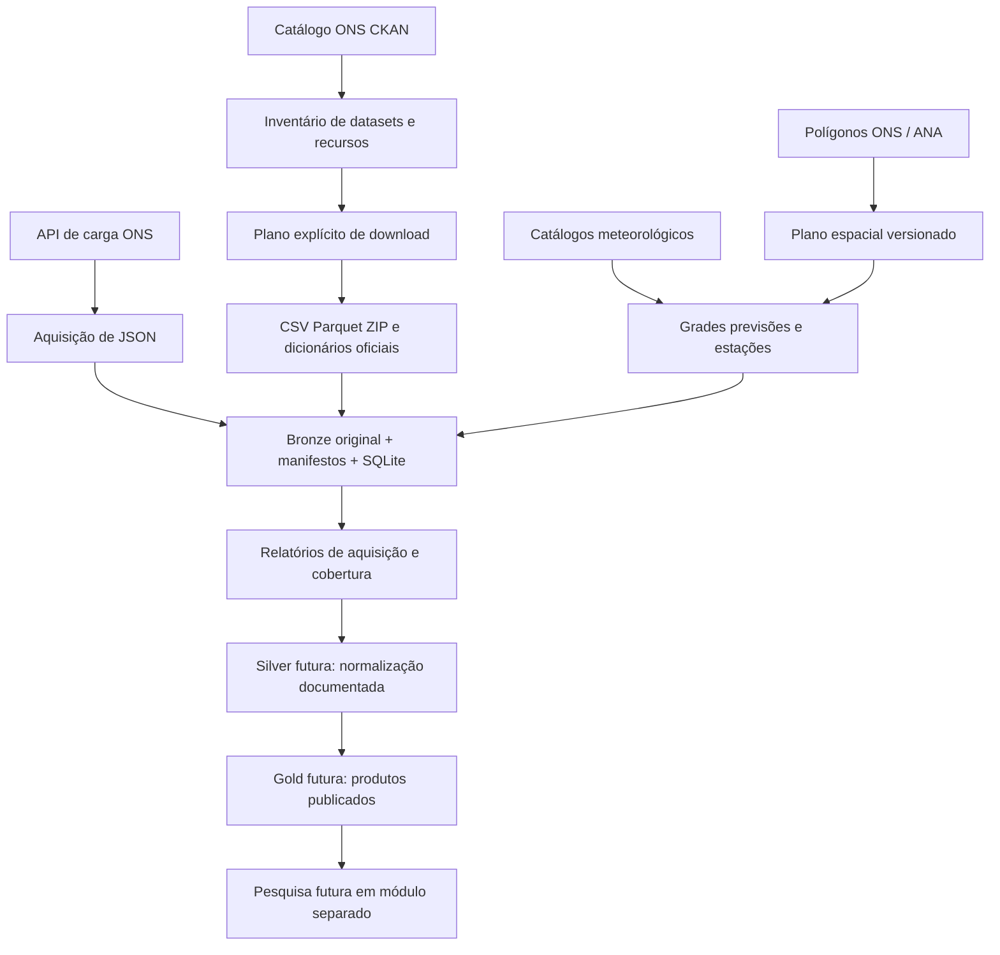

# Arquitetura de aquisição e organização dos dados

O desenho abaixo começou na aquisição. Atualização: o tratamento Silver e o pipeline recorrente já foram implementados; operação, contratos, frequências e limites estão em [pipeline_diario.md](pipeline_diario.md). Gold e pesquisa estatística continuam futuras.

## Stack por etapa

| Componente | Agora | Depois |
|---|---|---|
| Aquisição | Python 3.13, urllib, JSON, CSV, ZIP | Clientes oficiais ECMWF/CDS quando necessário |
| Auditoria | SQLite, SHA-256 e manifestos JSON | Alertas e política de retenção |
| Inspeção tabular | DuckDB 1.5.6 | Parquet tipado na Silver |
| Geografia | ZIP shapefile original; planejador GeoPandas disponível | Interseção grade–polígono com pesos por área |
| Meteorologia | Registro de fontes; comando GFS retangular | xarray, cfgrib/ecCodes; validar suporte no Windows |
| Execução | CLI explícita e testes unittest | Agendador de Tarefas do Windows; orquestrador quando necessário |
| Publicação | Inventário e evidências | snapshots Silver/Gold e contratos |

Não é necessário adicionar Spark, Kafka, Kubernetes ou nuvem para o volume inicial. O Python do projeto vem do ambiente .venv configurado no PyCharm.

## Preferência de acesso

1. API do catálogo para descobrir recursos e guardar seus metadados.
2. Download HTTP direto das URLs retornadas pelo catálogo: Parquet para leitura eficiente, CSV para auditabilidade/comparação.
3. API de observações quando o produto só existir assim ou trouxer campos adicionais.
4. Scraping HTML apenas como adaptador explícito se não houver canal estruturado. Não foi necessário para descobrir os recursos ONS.

A API CKAN descreve arquivos; a API apicarga entrega outro produto, por área de carga. Não são intercambiáveis. A API pode apontar para Swagger no campo URL: o coletor não baixa essa página como se fosse observação.

## Separação de domínios

- Energia: operação realizada, programação, geração, intercâmbios, restrições, disponibilidade e hidrologia operacional.
- Meteorologia: observações de estação, estimativas de satélite, reanálises e previsões em coleções distintas.
- Geografia: polígonos, estações, ativos e correspondências de identificadores, sem inferir correspondência apenas por nome.

A Bronze mantém source/dataset/resource_id/hash. A classificação de domínio está no inventário, sem duplicar fisicamente a mesma aquisição. Reservatórios e cadastros devem ser fotografados periodicamente quando a origem só oferece o estado atual.

## Contrato de aquisição

Cada tentativa tem ID, URL, início, fim, status e erro no SQLite. Cada sucesso tem manifesto com hash SHA-256, bytes, headers, URL final e contexto. Conteúdo igual reutiliza o objeto; revisões criam objetos distintos. Download parcial usa .part e não é publicado como sucesso. Arquivos HTML inesperados e vazios são rejeitados. Limite padrão: 100 MB por arquivo, ajustável. GET tem até três tentativas para erros transitórios.

O status downloaded prova recebimento do payload; não é um selo de qualidade semântica. APIs podem retornar JSON com erro, vazio ou paginação. Essa validação deve preceder qualquer uso na Silver. Interrupções abruptas ficam com status started para investigação.

Não armazenar tokens em URLs ou manifestos: os comandos atuais são para fontes públicas. Adaptadores autenticados futuros devem usar credenciais locais fora do Git e omitir headers sensíveis. O armazenamento atual dos cabeçalhos refere-se às respostas públicas.

## Tempo e qualidade

- Preservar horário e unidade conforme fonte, junto com a definição do intervalo.
- Não pressupor que todos os dados ONS usam Brasília: o dicionário da API de carga programada explicita din_referenciautc e final do intervalo semi-horário.
- ingested_at é quando coletamos. Last-Modified, data do arquivo e metadata_modified não comprovam a publicação histórica de cada registro.
- Guardar emissão da previsão, validade, membro, resolução, versão, altura/nível e período de acumulação.
- Medir cobertura por entidade, duplicatas nas chaves propostas, nulos, schema e alterações. Não preencher ou truncar valores nesta fase.
- Conferência CSV/Parquet usa EXCEPT ALL nas duas direções, preservando multiplicidade; registra tipos inferidos e suas coerções.
- Comparar API/CSV exige comprovar mesma variável, definição de carga, entidades, intervalo e revisão. Nenhuma equivalência API/CSV foi declarada.

## Aquisição espacial

Primeiro baixar e versionar os polígonos oficiais. Inspecionar CRS, IDs, geometrias e significado da área. O arquivo de bacias amplas não é automaticamente a área incremental de cada reservatório.

plan_weather.py inspeciona o shapefile e gera retângulos WGS84 por ID explícito. A aquisição de 10/11/2026 usou discover_weather.py e download_weather.py: 31 feições foram inspecionadas e seis têm invalidez geométrica na fonte. A grade GFS foi obtida pelo retângulo envolvente, sem reparo dos polígonos. Depois do download é preciso calcular interseções e pesos com geometrias validadas; não usar centróide como substituto de chuva média da bacia. Preservar grade original, máscara e versão do polígono. Não somar diretamente áreas de drenagem sobrepostas.

Para eólica/solar, usar localizações dos parques/conjuntos; para carga, regiões consumidoras. Os polígonos de bacias atendem principalmente à hidrologia.

## Critério de passagem para limpeza

O próximo marco exige: inventário aprovado, acesso repetível, amostras e histórico dimensionados, dicionários preservados, chaves e intervalos documentados, relatório de cobertura e decisão explícita sobre revisão/latência. Só então implementar a Silver. Estatística e modelagem ficam fora desta entrega.
