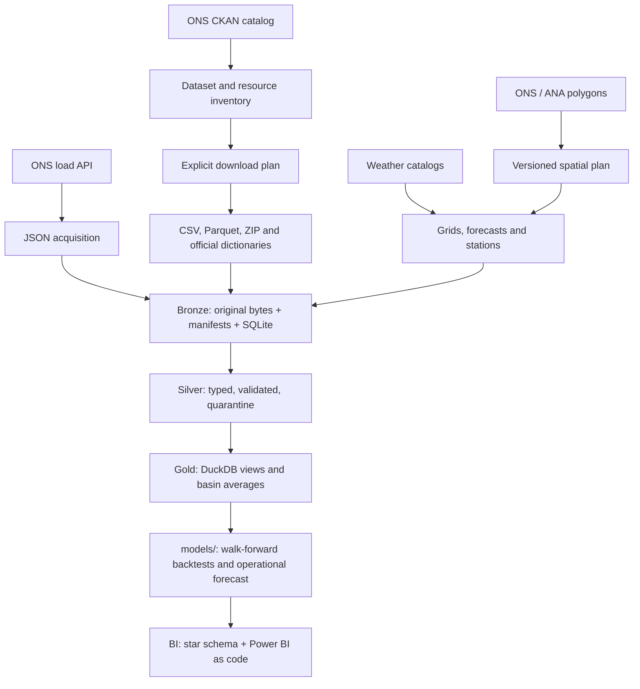

# Architecture

From raw downloads to a daily forecast and a dashboard. Operations (frequencies, contracts, limits) are described
in [pipeline_diario.md](pipeline_diario.md); results in [results.md](results.md) and [paper.md](paper.md).

## Stack by stage

| Component | Implementation |
|---|---|
| Acquisition | Python 3.13, urllib, JSON, CSV, ZIP; retries for transient errors |
| Audit trail | SQLite attempt log, SHA-256 content addressing, JSON manifests |
| Tabular processing | DuckDB (views, no copies), pandas, typed Parquet in Silver |
| Geography | GeoPandas: geometry repair, exact cell-area weights in EPSG:5880 |
| Weather | GRIB/NetCDF readers for GFS and ECMWF; Open-Meteo archived forecasts as issued |
| Models | scikit-learn (per-hour Ridge, HistGradientBoosting), block bootstrap, empirical prediction bands |
| Scheduling | Windows Task Scheduler every 15 minutes; each source has its own cadence |
| Delivery | Power BI project as code (PBIP: TMDL model, PBIR report), Markdown reports |
| Quality | 91 offline pytest tests incl. leakage tests, CI on GitHub Actions |

Spark, Kafka, Kubernetes or a cloud warehouse are not needed at this volume (a few GB, hourly data): DuckDB on a
laptop handles every query in seconds.

## Access preference

1. Catalog API to discover resources and store their metadata.
2. Direct HTTP download of the URLs returned by the catalog: Parquet for efficient reading, CSV for auditability.
3. Observation APIs when a product exists only there or carries extra fields.
4. HTML scraping only as an explicit adapter when no structured channel exists (not needed for ONS).

The CKAN API describes files; the load API delivers a different product, per load area. They are not interchangeable.

## Domain separation

- **Energy:** verified operation, schedules, generation, interchange, curtailment, availability and operational hydrology.
- **Weather:** station observations, satellite estimates, reanalysis and forecasts in separate collections.
- **Geography:** polygons, stations, assets and identifier mappings, never matched by name alone.

Bronze keeps source / dataset / resource_id / hash. Reservoir and registry snapshots are taken periodically when the
source only offers the current state.

## Acquisition contract

- Every attempt has an ID, URL, start, end, status and error in SQLite.
- Every success has a manifest with SHA-256, bytes, headers, final URL and context.
- Identical content reuses the stored object; revisions create new objects.
- Partial downloads use `.part` and are never published as success; unexpected HTML and empty files are rejected.
- Default limit 100 MB per file; up to three GET attempts for transient errors.
- `downloaded` proves the payload arrived, not that it is semantically valid; that check happens before Silver.
- No tokens in URLs or manifests; authenticated adapters must read local credentials kept out of git.

## Time and quality

- Keep times and units as published, together with the interval definition.
- Do not assume Brasília time for every ONS dataset: only the load API and weather data declare UTC explicitly.
- `ingested_at` is when we collected; `Last-Modified` and catalog dates do not prove when each record was published.
- For forecasts, keep issue time, valid time, member, resolution, level and accumulation period.
- Measure coverage, duplicate keys, nulls and schema changes; never fill or truncate values silently.
- CSV/Parquet checks use `EXCEPT ALL` in both directions to preserve multiplicity.

## Spatial processing

The official basin polygons are downloaded and versioned. Six of the 31 features have invalid geometry at the
source and are repaired explicitly. Grid cells are intersected with each polygon and weighted by their exact area in
an equal-area projection; missing cells never become zero, and each value carries the fraction of the basin covered.
Overlapping drainage areas are not summed directly. Wind and solar use plant locations weighted by installed capacity;
load uses the main cities of each subsystem.

## Models and delivery

- `models/` reads Gold views, cleans the data and runs leakage-safe walk-forward backtests (see [paper.md](paper.md)).
- `scripts/prever_carga_liquida.py` produces the daily D+1 and D+2 net-load forecast with an 80% band.
- `scripts/exportar_bi.py` builds a star schema in Parquet; `scripts/gerar_projeto_bi.py` writes the Power BI semantic
  model (TMDL) and the five report pages (PBIR), so the dashboard is versioned like code.
